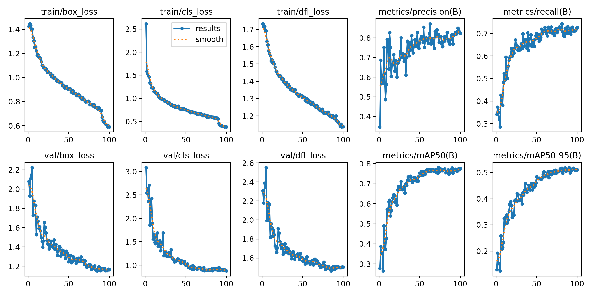
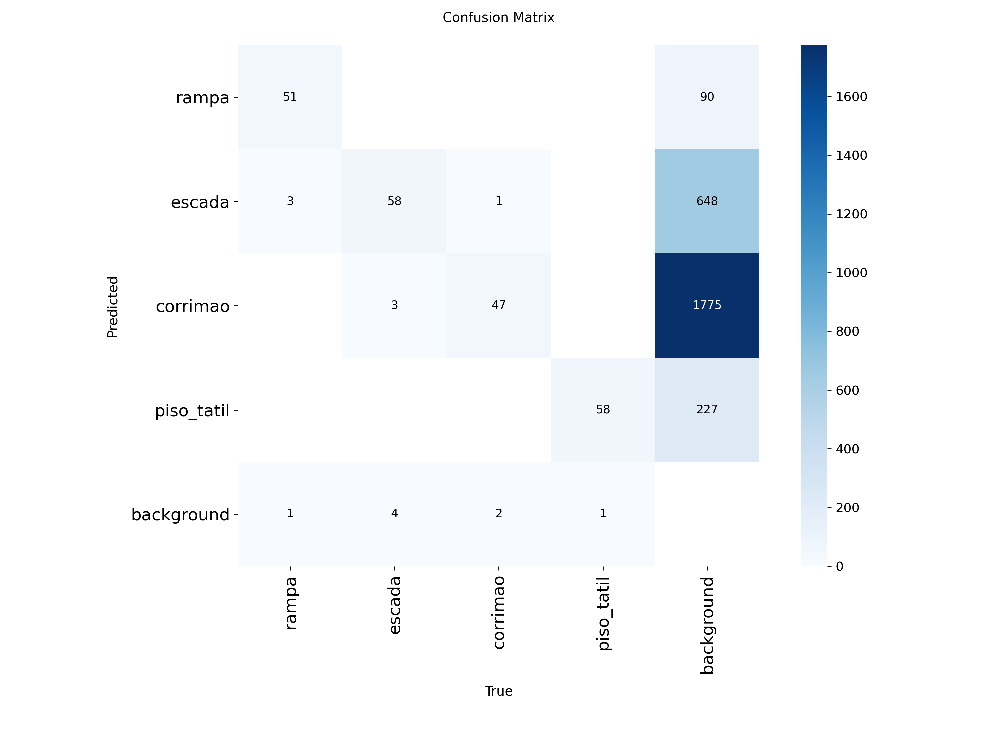
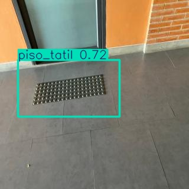
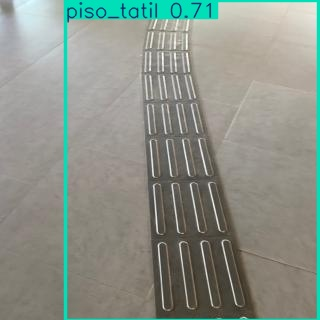
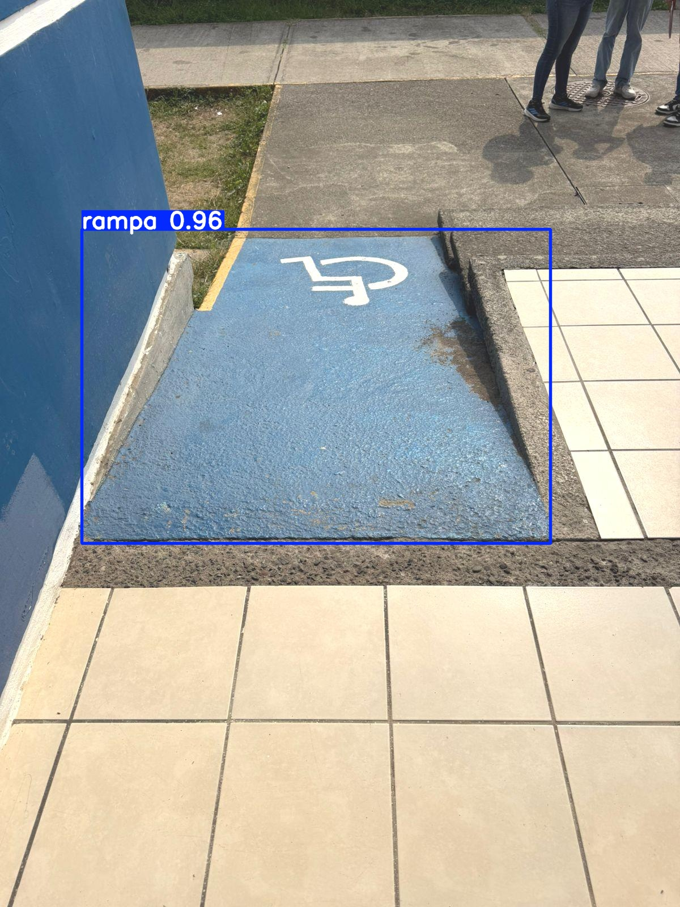
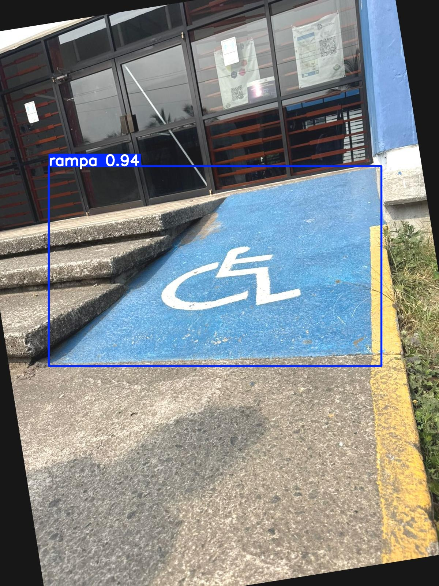
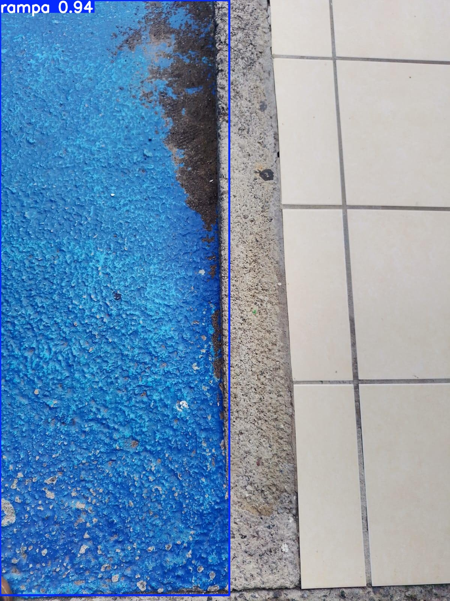
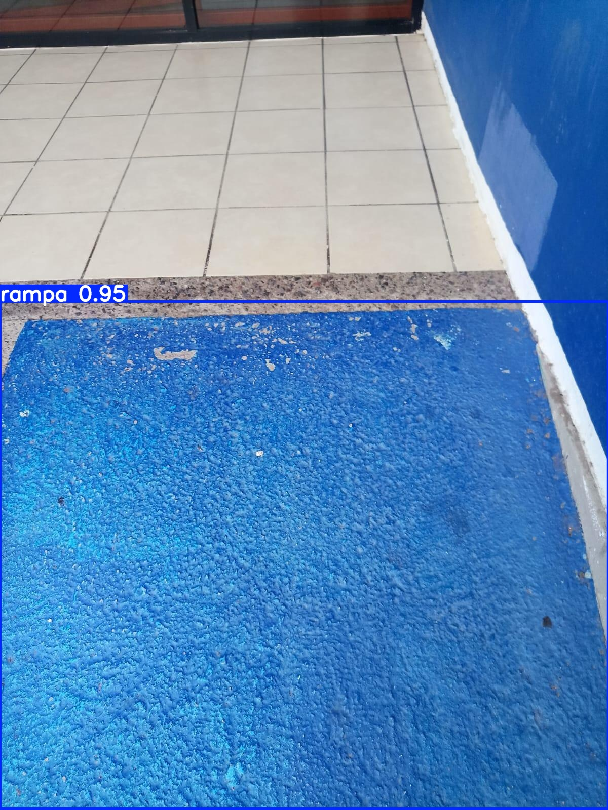

# Inclui+ Vision

Detecção de recursos e barreiras de acessibilidade em fotos e em vídeo em tempo real, com um modelo YOLO11 customizado. Projeto da atividade *Applied Computer Vision | Enxergando o mundo real*, no contexto da plataforma Inclui+.

## Integrantes

| Nome completo | RM |
|---|---:|
| Kaiky Alvaro de Miranda | RM98118 |
| Bruno Eduardo Caputo Paulino | RM558303 |
| Juan Pinheiro de França | RM552202 |
| Lucas Rodrigues da Silva | RM98344 |

> **Estado do repositório.** O modelo está treinado e os pesos estão em `weights/best.pt`. No conjunto de teste ele atinge **mAP@50 de 0,797**; os detalhes e as ressalvas estão em [Resultados](#resultados). Para ver funcionando, basta instalar as dependências e rodar `python src/realtime.py`.

## O que o modelo detecta

| Classe | Descrição | Categoria no Inclui+ |
|---|---|---|
| `rampa` | Rampa de acesso | Mobilidade |
| `escada` | Escada ou degrau (possível barreira) | Mobilidade |
| `corrimao` | Corrimão em escada ou rampa | Mobilidade |
| `piso_tatil` | Piso tátil direcional ou de alerta | Visão |

Além das detecções, os scripts emitem um alerta de barreira quando há **escada sem rampa** na cena.

A proposta inicial previa mais quatro classes (`elevador`, `barra_apoio`, `vaga_pcd` e `simbolo_acessibilidade`). Elas ficaram de fora por falta de imagens anotadas. O código já conhece as categorias delas (`src/categorias.py`): para incluí-las basta acrescentar as fontes e os nomes em `dataset/fontes.yaml` e treinar de novo.

## Estrutura

```
inclui-vision/
├── notebooks/treinamento.ipynb   # passos 3 e 4, no Google Colab
├── dataset/
│   ├── fontes.yaml               # fontes de imagens e mapa de classes de cada uma
│   ├── data.yaml                 # classes e pastas, no formato do Ultralytics
│   └── README.md                 # datasets usados e como ampliar o dataset
├── src/
│   ├── categorias.py             # classes, categorias do Inclui+ e regra de barreira
│   ├── preparar_dataset.py       # une as fontes, unifica classes e divide em 70/20/10
│   ├── ver_amostras.py           # grade de imagens anotadas, para conferir o dataset
│   ├── avaliar.py                # métricas no teste, matriz de confusão e exemplos
│   ├── realtime.py               # detecção na webcam ou na câmera do celular
│   ├── relatorio.py              # relatório de acessibilidade de uma foto
│   └── util_dataset.py           # leitura de datasets no formato YOLO
├── tests/                        # testes que rodam sem GPU e sem o modelo
├── weights/best.pt               # modelo treinado (YOLO11n, 4 classes)
├── results/                      # métricas, gráficos e exemplos do modelo treinado
├── docs/roteiro_video.md         # roteiro do vídeo de demonstração
└── requirements.txt
```

## Como rodar

Todos os comandos partem da raiz do repositório.

```bash
python -m venv .venv
source .venv/bin/activate          # no Windows: .venv\Scripts\activate
pip install -r requirements.txt
```

O modelo treinado já vem no repositório. Para usá-lo, vá direto aos passos 3 e 4. Os passos 1 e 2 refazem o dataset e o treino.

### 1. Montar o dataset

1. Baixe os quatro datasets públicos listados em [`dataset/README.md`](dataset/README.md), no formato **YOLOv11** (ou YOLOv8).
2. Extraia cada um em `dataset/brutos/<nome-da-fonte>/`, com os nomes de pasta que estão em `dataset/fontes.yaml`.
3. Para acrescentar outra fonte, inclua uma entrada no `fontes.yaml` com o mapa das classes dela para as nossas.
4. Rode a preparação e confira o resultado:

```bash
python src/preparar_dataset.py --config dataset/fontes.yaml --saida dataset --limpar
python src/ver_amostras.py --n 12 --saida results/amostras_treino.jpg
```

O primeiro comando imprime quantas imagens cada classe tem em cada conjunto e avisa quais estão abaixo da meta de 300. O segundo salva uma grade com as anotações desenhadas: se uma rampa aparecer como escada, o mapa de classes está errado.

O que a preparação faz:

- traduz os nomes de classe de cada fonte (`stairs`, `upstairs` e `downstairs` viram `escada`) e descarta as classes fora do escopo;
- divide em 70% treino, 20% validação e 10% teste, com semente fixa, sorteando pela classe mais rara de cada foto para que mesmo as classes pequenas apareçam nos três conjuntos;
- mantém no mesmo conjunto as cópias aumentadas de uma mesma foto (os arquivos `.rf.<hash>` do Roboflow), para a foto não vazar do treino para o teste;
- quando há fotos próprias entre as fontes, grava também `data_publico.yaml`, com o treino só de fontes públicas e a mesma validação e o mesmo teste, para medir quanto as fotos próprias ajudam.

### 2. Treinar e avaliar

Abra [`notebooks/treinamento.ipynb`](notebooks/treinamento.ipynb) no Google Colab, ative a GPU T4 e siga as células. O notebook prepara o dataset, treina o `yolo11n` a partir dos pesos do COCO e avalia no conjunto de teste. As saídas da execução do grupo estão salvas no próprio arquivo.

No fim, traga para o repositório o `weights/best.pt` e a pasta `results/`.

Para reavaliar no computador um modelo já treinado:

```bash
python src/avaliar.py --pesos weights/best.pt --data dataset/data.yaml --split test
```

### 3. Detecção em tempo real

```bash
python src/realtime.py                                   # webcam do computador
python src/realtime.py --fonte 1                         # câmera do celular via DroidCam ou Iriun
python src/realtime.py --fonte gravacao.mp4 --gravar demo.mp4
```

A janela mostra as bounding boxes, um resumo por categoria do Inclui+, o FPS e o alerta de escada sem rampa. A tecla `q` encerra. Em computador sem GPU a taxa de quadros é bem menor que a medida na T4.

Uma detecção continua valendo por 1 segundo depois de sumir (`--janela`), para o painel não piscar e o alerta não disparar só porque a rampa saiu do enquadramento por um instante. Com `--janela 0` a análise é quadro a quadro.

O terceiro comando processa um vídeo gravado com o celular e salva o resultado anotado. É o jeito mais prático de gravar a demonstração em locais onde não dá para levar o notebook.

### 4. Relatório de uma foto

```bash
python src/relatorio.py foto.jpg --saida results/exemplos/foto.jpg
```

```
Relatório de acessibilidade — Inclui+
  [Mobilidade] corrimao: 1
  [Mobilidade] escada: 2
  [Visão] piso_tatil: 1
  ATENÇÃO, barreira: Escada sem rampa alternativa
```

A saída acima é um exemplo do formato. Com `--json` ela é estruturada, no formato que a plataforma consumiria.

### 5. Testes

```bash
python -m unittest discover -s tests -v
```

Cobrem a preparação do dataset, as categorias, a regra de barreira, o painel do vídeo e as tabelas de métricas. Não precisam de GPU, de imagens reais nem do modelo treinado.

## Resultados

Modelo: YOLO11n, *fine-tuning* de 100 épocas a partir dos pesos do COCO, imagens de 640 px, em uma GPU T4 do Google Colab (1 h 25 min de treino).

### Dataset

| Classe | Imagens no treino | Na validação | No teste |
|---|---:|---:|---:|
| `rampa` | 1.568 | 108 | 54 |
| `escada` | 416 | 109 | 54 |
| `corrimao` | 231 | 65 | 32 |
| `piso_tatil` | 386 | 110 | 55 |
| Sem nenhum recurso | 12 | 3 | 2 |
| **Total** | **2.382** | **330** | **165** |

### Métricas

| Conjunto | mAP@50 | mAP@50-95 | Precisão | Recall |
|---|---:|---:|---:|---:|
| Teste (166 imagens, 229 objetos) | 0,797 | 0,561 | 0,814 | 0,745 |
| Validação (330 imagens, 475 objetos) | 0,779 | 0,519 | 0,819 | 0,705 |

Por classe, no teste:

| Classe | Precisão | Recall | mAP@50 | mAP@50-95 |
|---|---:|---:|---:|---:|
| `rampa` | 0,891 | 0,909 | 0,928 | 0,863 |
| `escada` | 0,835 | 0,699 | 0,786 | 0,525 |
| `corrimao` | 0,555 | 0,440 | 0,511 | 0,310 |
| `piso_tatil` | 0,977 | 0,932 | 0,963 | 0,545 |

Na T4, a inferência levou 6,5 ms por imagem, ou 12,5 ms com o pré e o pós-processamento: cerca de 80 imagens por segundo.

`piso_tatil` e `rampa` passam de 0,92 de mAP@50. `corrimao` é a classe fraca: o modelo encontra menos da metade dos corrimãos. É a classe com menos imagens, o objeto é fino e inclinado, e nem todo corrimão das fotos está anotado.

**Duas ressalvas sobre esses números:**

- **O teste foi refeito depois do treino.** Entre o treino e a avaliação, o mapa de classes do piso tátil mudou em 6 caixas, o que refez o sorteio desse dataset: o teste avaliado tem 166 imagens, e não as 165 da tabela acima. Parte das fotos de teste de `piso_tatil` pode ter sido vista no treino, então o 0,963 dessa classe deve ser lido com cautela. Na validação, feita durante o treino, o valor foi 0,907. O `fontes.yaml` do repositório está como no treino.
- **As rampas são muito parecidas entre si.** O dataset de rampas tem muitas fotos do mesmo local em treino, validação e teste. O mAP@50-95 de 0,863 provavelmente superestima o desempenho em rampas diferentes.

### Curvas de treino e matriz de confusão





O modelo quase não troca uma classe por outra: são 7 trocas em 229 objetos. O que pesa são as detecções em regiões sem anotação, principalmente de corrimão (1.775) e de escada (648). Esse volume não combina com a precisão medida, o que indica detecções de confiança muito baixa, abaixo do limiar de 0,5 que os scripts usam. Parte delas pode ser corrimão real que os datasets não anotaram.

### Exemplos no conjunto de teste

| | | |
|---|---|---|
|  |  |  |
|  |  |  |

Arquivos em `results/`: `metricas.md` (tabelas do teste), `results.csv` e `results.png` (curvas por época), `confusion_matrix.png`, `amostras_treino.jpg` (imagens de treino com as anotações) e `exemplos/`.

### O que não foi feito

- **Fotos próprias.** O dataset tem só imagens públicas. As fotos do grupo não chegaram a ser anotadas.
- **Comparação com o `yolo11s`.** O treino foi interrompido pelo limite de uso do Colab e ficou de fora.

## Limitações conhecidas

- **Só imagens públicas.** O piso tátil e as rampas de locais brasileiros podem ser diferentes dos que o modelo viu no treino.
- **Anotações incompletas ao unir datasets.** Cada dataset público só anota as próprias classes: um dataset de escadas não marca os corrimãos que aparecem nas fotos. Para o modelo, esses corrimãos viram fundo.
- **O alerta vale só para o que a câmera viu.** Uma rampa fora do enquadramento não é considerada.
- **O modelo detecta presença, não conformidade.** Ele não mede a inclinação da rampa nem a largura da porta; uma rampa íngreme demais conta como rampa.
- **Caixas em objetos finos e inclinados.** Um corrimão em diagonal ou uma faixa de piso tátil ocupam pouco da própria bounding box, o que reduz o mAP@50-95 dessas classes.

## Créditos e licenças

- [Ultralytics YOLO11](https://docs.ultralytics.com/models/yolo11/), licença AGPL-3.0.
- Datasets públicos do Roboflow Universe, todos sob CC BY 4.0, que exige atribuição:

| Dataset | Autor | Licença | Classe no projeto |
|---|---|---|---|
| [Stairs \| Handrail Detector](https://universe.roboflow.com/itlabroom/stairs-handrail-detector) | ITLabRoom | CC BY 4.0 | `escada`, `corrimao` |
| [Stairs](https://universe.roboflow.com/barrierfreenavigation/stairs-u437q) | BarrierFreeNavigation | CC BY 4.0 | `escada` |
| [detector-rampas](https://universe.roboflow.com/lockytobebe/detector-rampas/dataset/2), versão 2 | lockytobebe | CC BY 4.0 | `rampa` |
| [Braille Block Detect](https://universe.roboflow.com/yourking/braille-block-detect/dataset/3), versão 3 | yourking | CC BY 4.0 | `piso_tatil` |
